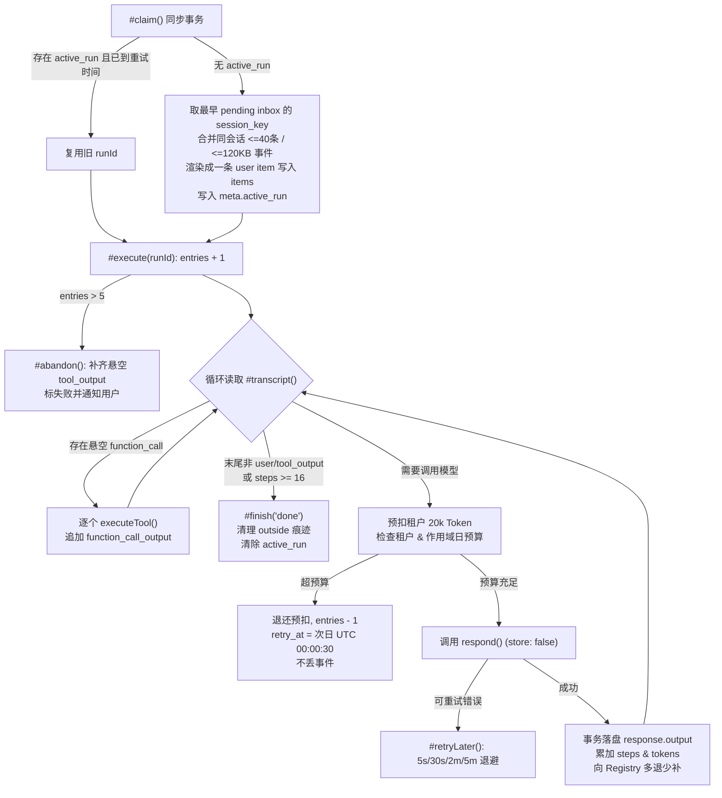

# 代码导读（二）：BrainAgent 事件循环、持久化与发件箱

本文档聚焦系统最核心的大脑模块（`src/brain/schema.ts`、`src/brain/agent.ts`、`src/brain/tools.ts`、`src/brain/prompt.ts`），拆解它如何仅靠**「一个 SQLite 数据库 + 一个 Durable Object `alarm()`」**，不依赖外部消息队列或 Workflow 引擎，实现可随时断电重启的确定性事件循环、防外部文本污染隔离与严格有序发件箱。

> 系列导读：[（一）核心对象、作用域与入口连接器](code-walkthrough.zh-CN.md) · [架构概览](architecture.zh-CN.md) · [审批机制](approvals.zh-CN.md)

---

## 1. 一张数据库装下五大原语（`src/brain/schema.ts`）

每个作用域（`tenant:kind:id`）对应一个独立的 `BrainAgent` Durable Object 与一份独享 SQLite 数据库。表结构采用只追加、事务化版本演进（目前 18 步 `MIGRATIONS`，对象首次唤醒时在 `constructor` 中由 `migrate()` 自动追平），共分为 4 组：

### 1.1 事件与对话层（驱动核心循环）

| 表名 | 核心字段 | 作用与关键约束 |
|---|---|---|
| **`inbox`** | `source`, `source_id`, `kind`, `session_key`, `principal`, `text`, `data`, `reply_to`, `status`, `run_id`, `received_at` | 所有触发的唯一入口。`UNIQUE (source, source_id)` 保证幂等去重；状态流转 `pending → claimed → done \| dead`；索引 `inbox_status` 和 `inbox_run` 加速认领与批量查询。 |
| **`sessions`** | `id`, `session_key`, `target`, `created_at`, `updated_at` | 区分同一作用域内的多条对话流（如不同 PR、群主聊与话题），并记住最近一次可回复事件的出站地址 `target`。 |
| **`items`** | `session_id`, `seq`, `run_id`, `is_user`, `item`, `outside` | **直接按 OpenAI Responses API 原生 JSON 格式存储整条对话记录**（`user` 消息、模型推理、`function_call`、`function_call_output`）。`is_user` 用于按用户轮次边界切窗口；`outside` 用于标记外部连接器工具返回文本及其清理态（`0 / 1 / 2`）。 |
| **`runs`** | `id`, `session_id`, `status`, `entries`, `steps`, `retry_at`, `input_tokens`, `output_tokens`, `started_at`, `ended_at`, `error` | 记录一次唤醒执行的进度：重入次数 `entries`、模型步数 `steps`、退避唤醒时间 `retry_at` 与 Token 用量。 |

### 1.2 长期状态层

| 表名 | 核心字段 | 作用与关键约束 |
|---|---|---|
| **`memory`** | `path`, `content`, `updated_at` | 按 Markdown 路径存储跨 `run` 持久记忆（上限 200 个文件）。`instructions.md` 和 `index.md` 会在每次调模型前自动注入系统提示词。 |
| **`timers`** | `id`, `due_at`, `every_s`, `session_key`, `note`, `data`, `status` | 一次性或周期定时器（上限 50 个活跃）。**定时器绝不直接调模型**，到期只在事务中向 `inbox` 插入一条 `timer` / `task.overdue` 事件。 |

### 1.3 发件与任务台账层

| 表名 | 核心字段 | 作用与关键约束 |
|---|---|---|
| **`outbox`** | `id`, `idem`, `run_id`, `target`, `text`, `status`, `attempts`, `next_at`, `started`, `receipt`, `ask`, `closed`, `review`, `private` | 严格按 `id` 升序投递的发件箱。`idem` 防重发；`started` 标记已发起投递；`receipt` / `ask` / `closed` 支撑审批卡片对账与关闭；`review` 支撑 PR 行级代码评审；`private` 标记含外部敏感文本的消息送达后立刻擦除。 |
| **`tasks`** / **`task_events`** | `tasks(id, op_id, status, requested_by, pending, answering, ...)`<br/>`task_events(task_id, seq, kind, body)` | 追踪派发给 `TaskSandbox` 的异步任务（`op_id = call_id` 保证工具重试不重复派活），按 `(task_id, seq)` 对沙箱回报去重。 |

### 1.4 审计与安全辅助层

- **`meta`**：键值元信息（`schema_version`、`active_run`、`tokens:YYYY-MM-DD`、`housekeeping_at`、`default_target`）。
- **`audit`**：只追加审计日志（记录派活、审批、取消、修改 `instructions.md`、调用外部连接器工具），保留 1 年。
- **`revisions`**：记录可编辑外部评论的最新修订时间戳与文本指纹 `holder`。
- **`used_codes`**：作用域内所有用过的 4 位确认码，永不重复分配。
- **`unsettled`**：记录已离开等待态但尚未确认沙箱是否收到决定的审批问题，交由后台定时向沙箱核对终态。

---

## 2. 单 `alarm()` 多路复用与自愈机制

Cloudflare 每个 Durable Object 只有一个 `alarm`。`BrainAgent` 将所有后台推进统一收拢到 `alarm()` 中，利用 DO 平台「**同一对象 `alarm()` 绝不并发重入**」的特性，天然实现**同一作用域同一时刻最多一个 `run`**，无需额外锁机制。

### 2.1 构造器自愈（防「落盘成功但设闹钟前崩溃」）

如果进程恰好死在把事件写入 SQLite 与调用 `setAlarm()` 之间，事件原本会永远沉睡。`BrainAgent` 构造器通过 `ctx.blockConcurrencyWhile()` 在对象每次被激活时做一次自检：只要当前没有挂起的 alarm，就立刻跑一次 `#rearm()` 扫表补设闹钟。

### 2.2 `alarm()` 每次唤醒的执行顺序

```text
alarm()
 ├── 1. #fireTimers(now)     到期定时器转为 inbox 事件（跳过休眠期错过的周期）
 ├── 2. #housekeeping(now)   每日清理 30 天前已完成记录（inbox 去重键保留 1 年）
 ├── 3. #flushOutbox()       严格按序投递待发消息 + 旁路对账已关闭的审批提问
 ├── 4. #settleQuestions()   向沙箱核对 unsettled 表中未决审批的真实结局
 ├── 5. 循环最多 3 次：
 │       ├── runId = #claim()   有 active_run 则续跑，否则认领最早 pending 会话
 │       ├── #execute(runId)    执行一轮完整的「悬空工具 → 模型 → 工具」循环
 │       ├── #flushOutbox()     立刻把刚产生的回复发出去
 │       └── 若 active_run 仍在（如等待退避重试或超预算暂停），立即跳出
 └── finally: #rearm()       汇总 6 类待办的最早触发时间，设下一次 alarm（全空则休眠）
```

**几个关键工程细节**：
- **周期定时器不补发风暴**：`#fireTimers()` 计算下一次触发时间时取 `Math.max(due_at + every_s * 1000, now + every_s * 1000)`，休眠期间错过的多次周期全部跳过，绝不会醒来后瞬间连发几十条提醒。
- **两段式数据清理（`#housekeeping`）**：30 天前的已完成 `inbox` 只清空 `text / data / reply_to` 释放空间，但保留 `(source, source_id)` 骨架满 365 天——因为外部签名 Webhook 本身不过期，保留去重键才能持续防重放；清理旧 `items` 时同样只从 `is_user = 1` 边界截断，保证留下的对话结构合法。
- **`#rearm()` 统一计算最早唤醒点**：扫描 `active_run`、`pending inbox`、最早 `active timer`、队首 `pending outbox`、待对账 `reconciling outbox`、待核对 `unsettled` 以及下次 `housekeeping_at`，取最小值（不早于 `now + 50ms`）设为下一次闹钟。没有任何待办时直接返回，DO 彻底休眠、零算力开销。

---

## 3. 一次 `run` 的生命周期：认领、步进、崩溃续跑与放弃



### 3.1 批处理窗口与同步事务认领（`ingest` + `#claim`）

- 外部事件写入 `inbox` 时，`ingest()` 设一个 `BATCH_WINDOW_MS = 2_000`（2 秒）后的闹钟，让连续发出的多条消息有机会聚合成同一批处理。
- `#claim()` 在单个 `transactionSync` 中锁定最早一条 `pending` 事件所属的 `session_key`，把该会话下最多 `40` 条、总计不超过 `120 KB` 的待处理事件标记为 `claimed`，按 `[时间戳] 类型 from 身份: 文本` 拼成一条 `role: "user"` 记录写入 `items`，同时把最近一条带 `reply_to` 的地址更新为 `sessions.target`，最后写下 `meta.active_run = runId`。

### 3.2 「对话记录即进度」的崩溃续跑（`danglingCalls`）

系统不引入外部 Workflow 状态机，而是把 `items` 表本身作为执行进度：
1. 模型调用采用无状态模式（`store: false`、`parallel_tool_calls: false`、`include: ["reasoning.encrypted_content"]`），返回的 `response.output` 在单事务内全量追加到 `items`。
2. 每次循环先跑 `danglingCalls(items)`，找出所有**已有 `function_call` 但尚无对应 `function_call_output`** 的调用并依次执行、落盘输出。
3. **重部署 / 崩溃恢复**：若进程在第 `k` 个工具执行前后意外中断，重启后 `alarm()` 认领同一个 `active_run`、`entries + 1`，从 `danglingCalls` 原地续跑未落盘的工具调用。由于所有带副作用的工具均以 `call_id` 为幂等键（发消息 `msg:${callId}`、定闹钟 `tmr_${callId}`、派任务 `tasks.op_id = callId`），即使崩溃发生在「副作用已发生但输出未落盘」之间，重跑也不会造成重复副作用。
4. **每次 `await` 之后强校验 `#stillActive(runId)`**：防止异步等待期间状态被外部改变后继续写脏数据。

### 3.3 对话窗口切分（`#transcript`）

模型每次最多读取最近 `MAX_TRANSCRIPT_ITEMS = 80` 条 `items`，但绝不能从工具输出或推理项中间截断（否则 API 会因缺少配对的 `function_call` 报错）。`#transcript()` 通过 `is_user = 1` 定位窗口起点之后的第一个用户轮次作为起始 `seq`；如果最新一轮本身工具调用就超过 80 条，则回退到最后一个 `is_user = 1`，宁可临时放宽窗口也不破坏单轮完整性。

### 3.4 预算暂停与彻底放弃（防无限卡死）

- **超日预算**：作用域每日上限 200 万 Token、租户每日上限 2,000 万 Token。一旦触顶，退还刚才预扣的 20k 额度，将 `entries` 减 1（不算故障），把 `retry_at` 设为次日 UTC `00:00:30` 暂停等待，消息一条不丢。
- **失败退避与 `#abandon()`**：模型可重试错误（429 / 5xx / 网络断连）按 `5s → 30s → 2m → 5m` 退避重试；超过 `MAX_RUN_ENTRIES = 5` 次重入或遇到不可重试错误时触发 `#abandon()`：
  1. 为所有悬空的 `function_call` 补写错误 `function_call_output`，保持对话历史合法、不拖累后续 `run`；
  2. 把本会话仍停留在 `dispatching` 的任务标记为 `failed`；
  3. 通知用户出错，将本批 `inbox` 标 `dead` 并清除 `active_run`，确保作用域永不被单条坏事件卡死。

---

## 4. 工具体系、记忆与「外部文本污点隔离」

### 4.1 「消息即工具」与内置工具集（`src/brain/tools.ts` & `prompt.ts`）

- **静默默认**：系统提示词明确约定，模型直接输出的文本只是内部笔记，不会展示给任何人；**只有显式调用 `send_message` 或 `send_review` 才会写入 `outbox`**。这使得 Agent 面对大量无需回复的 CI / PR 事件时可以自然沉默。
- **12 个内置工具**：
  - 沟通：`send_message`、`send_review`（支持绑定 40 位 commit SHA 与最多 30 条行级评论，不支持行级评论的渠道自动降级为纯文本）。
  - 记忆：`memory_list`、`memory_read`、`memory_write`、`memory_delete`。其中 `instructions.md` 写入/删除受 `#instructionEditors()` 保护——必须是纯由受信任渠道真人明确发言触发的 `run` 才能修改。
  - 定时：`set_timer`（延迟 5 秒至 1 年，周期最小 60 秒）、`list_timers`、`cancel_timer`。
  - 任务：`dispatch_task`、`task_status`、`answer_task`、`cancel_task`。

### 4.2 连接器只读外部工具的双重隔离（`#actingFor` + `outside` + `private`）

部分连接器允许在对话中向模型暴露只读外部工具（例如查询外部系统信息）。因为外部文档天然包含不可信文本（潜在 Prompt Injection）且可能含敏感内容，代码构建了一套严密的**开启准入 + 污点追踪 + 用后即焚**闭环：

1. **严苛的开启条件（`#actingFor(runId)`）**：
   只有同时满足以下所有条件时，`#toolsFor(runId)` 才会向模型暴露连接器工具：
   - 当前是私人单聊作用域（`scope.kind === "user"`）；
   - 本次 `run` 认领的**全部事件**均来自同一个受信任连接器、同一个私聊会话 `privateSessionKey(source, origin)`、同一验证来源 `origin`，且全部是该用户本人直接发出的普通消息（`data.direct === true`，不含按钮点击、卡片回复、跨话题路由、定时器或 Worker 回报）。
2. **运行时污点拦截（`#sawOutside(runId)`）**：
   一旦本次 `run` 触发了任何连接器工具调用，`#outside` 集合与 `items.outside = 1` 会立即被标记（即便工具报错也可能引用了外部文本，同样视为已读外部内容）：
   - 本次 `run` 剩余步骤中**彻底禁止 `memory_write` 和 `memory_delete`**（直接报错 `READ_OUTSIDE`），防止外部文本借提示词注入持久化篡改记忆或 `instructions.md`；
   - 本次 `run` 写入 `outbox` 的消息都会被标记 `private = 1`。
3. **结束后零残留清理（`#forgetOutside` + `#scrubDelivered`）**：
   - `run` 结束时，`#finish()` 调用 `#forgetOutside()`：**不仅移除外部工具返回原文，而是将整个 `run` 除用户原话外的所有模型产出与工具记录统一替换为固定占位说明（标 `outside = 2`）**，防止模型在回复或思考中转述外部机密进入长期对话记录；若 `run` 失败，报错信息也统一替换为固定脱敏文案 `ERROR_WITHHELD`。
   - 标记 `private = 1` 的 `outbox` 消息一旦成功送达（或进入 `dead` 终态），`#scrubDelivered()` 会立刻清空其在数据库中的正文内容，且投递报错日志同样脱敏为 `DELIVERY_WITHHELD`。

---

## 5. Outbox：严格有序投递、限流退避与审批卡片旁路对账

`#flushOutbox()` 负责把 `outbox` 里的消息可靠投递到外部系统，核心解决四个难题：

1. **严格队头有序（Head-of-Line Ordering）**
   循环每次只取 `status = 'pending'` 中 `id` 最小的一条；若它在退避等待（`next_at > now`）或本次投递失败，立刻 `return`，确保后发的消息绝不会越过前面未发出的消息造成对话乱序。
2. **`started = 1` 先落盘再发送（应对「发送成功但回执前崩溃」）**
   `#attempt()` 在调用 `deliver()` 之前先把 `outbox.started` 置为 `1`。送达成功后写入 `status = 'sent'`、`sent_at` 和 `receipt`（若连接器发现上次重试前其实已经发过，采用 `receipt.posted_at` 作为真实的提问发出时间）。
3. **已结束审批卡片的旁路对账（`withdrawn` vs `reconciling`）**
   如果队头是一条正在退避重发的审批卡片（`row.ask` 非空），而该审批在发送完成前就已被决策或超时撤回（`row.closed` 非空）：
   - 若 `started === 0`（从未真正发起过网络请求）：直接标 `withdrawn` 移出主队列，既不发送废卡片，也不阻塞后面的消息；
   - 若 `started === 1`（可能已经发到了飞书/GitHub 只是没收到响应）：立刻把状态改为 `reconciling` 移出主队列（不阻塞后续正常消息），然后在 `finally` 的 `#reconcileClosed()` 里用同一个幂等键 `idem` 独立重试拿回 `receipt`，再调用 `#showClosed()` / `amend()` 把远端卡片更新为「已批准 / 已拒绝 / 已失效」。
4. **尊重平台限流且防无限阻塞（`DeliveryDeferred`）**
   普通失败按 `2s → 10s → 60s → 5m → 15m` 共 5 次退避重试后标记 `dead`。若连接器抛出 `DeliveryDeferred(notBefore)`（例如平台返回 429 与 `Retry-After`），下次重试严格不早于 `notBefore`；但如果对方要求等待超过 `MAX_DEFERRAL_MS`（24 小时），为避免有序队列被永久堵死，直接判为 `dead` 并输出结构化告警日志 `message_undeliverable`。
