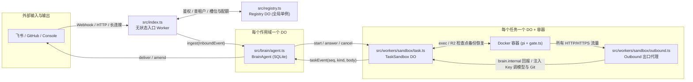
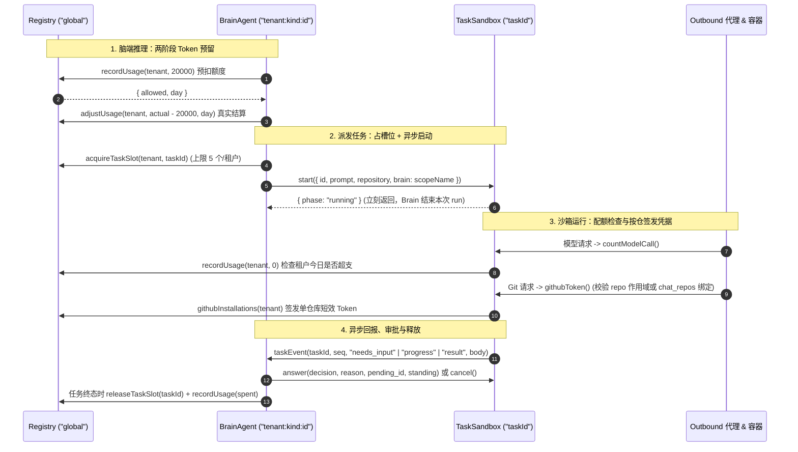

# 代码导读：核心对象、作用域与入口连接器

本文档按源码阅读顺序，梳理 `always-on-agents` 的整体心智模型、三个核心 Durable Object（`Registry`、`BrainAgent`、`TaskSandbox`）的协作契约、作用域（`Scope`）的设计边界，以及无状态入口与连接器的完整入站 / 出站逻辑。

> 系列导读：[（二）BrainAgent 事件循环、持久化与发件箱](brain-walkthrough.zh-CN.md) · [架构概览](architecture.zh-CN.md) · [连接器规范](connectors.zh-CN.md) · [审批机制](approvals.zh-CN.md)

---

## 1. 一句话心智模型与全局拓扑

整个系统运行在 Cloudflare Workers + Durable Objects（SQLite）+ Containers + R2 之上，平时休眠，被事件唤醒，耗时工作派给隔离沙箱。系统由 **3 类核心 Durable Object**（以及飞书长连接专用的 `FeishuLink` DO）组成，职责严格分离：

---

## 2. `Registry`、`BrainAgent`、`TaskSandbox` 之间的关系

### 2.1 实例粒度与寻址方式（`1 : N : M`）

三类对象都在 `wrangler.jsonc` 和 `src/env.ts` 中声明为带 SQLite 存储的 Durable Object，但生命周期和实例数量完全不同：

| Durable Object | 源码位置 | 实例粒度与寻址方式 | 核心职责 |
|---|---|---|---|
| **`Registry`** | `src/registry.ts` | **全局 `1` 个单例** `env.REGISTRY.getByName("global")` | 全平台唯一的一致性账本：租户、API Key 哈希、GitHub 安装 / 仓库归属、群与仓库绑定（`chat_repos`）、飞书应用配置与 Token 缓存、外部身份映射（`identities`）、租户级每日 Token 预算（2,000 万）与并发沙箱槽位（最多 5 个）。 |
| **`BrainAgent`** | `src/brain/agent.ts` | **每个作用域 `1` 个（共 `N` 个）** `env.BRAIN.getByName("tenant:kind:id")` | 常驻的「大脑」：拥有独立的 SQLite 数据库（`inbox`、`sessions`、`items`、`memory`、`timers`、`tasks`、`outbox`、`runs`、`audit`）。平时休眠，所有触发只写 `inbox` 并设闹钟；真正的推理循环只在单线程不重入的 `alarm()` 中短暂执行。 |
| **`TaskSandbox`** | `src/workers/sandbox/task.ts` | **每个任务 `1` 个 + `1` 个容器（共 `M` 个）** `env.TASKS.getByName(taskId)` | 一次性的「手脚」：托管一个断网的 Cloudflare Container 运行无头编程代理 `pi`。所有出网流量经 `Outbound` 代理校验、注入凭据并挂起需要人类审批的 `git push`。任务结束后保留 24 小时供排查，到期在 `#purge()` 中彻底删除容器、R2 检查点和自身记录。 |

### 2.2 三者之间的交互协议

### 2.3 四个关键的容错与隔离设计

1. **`state.brain` 兼顾回报路由与凭据授权边界**
   `BrainAgent` 派活时会把自己的作用域名传给 `TaskSandbox`（存为 `state.brain`）。它一方面决定 `TaskSandbox` 把异步回报送到哪个 `BrainAgent`，另一方面在 `TaskSandbox.githubToken()`（`src/workers/sandbox/task.ts`）中作为硬性授权依据：只有任务来自**目标仓库自己的 `repo` 作用域**，或者来自**管理员通过 `chat_repos` 显式绑定到该仓库的 `chat` 作用域**时，沙箱才能借用该仓库的 GitHub Token；其余单聊或未绑定的群聊任务拿不到任何 Token，只能匿名读公开仓库。
2. **两阶段 Token 预扣（防并发超支）**
   所有租户共用同一个上游 `OPENAI_API_KEY`。为避免同一租户下多个作用域同时调模型一起冲破每日上限，`BrainAgent` 在调模型前先向 `Registry.recordUsage()` 预扣 `MODEL_CALL_RESERVE`（20,000 tokens）并记住扣账日期 `reservedOn`（避免跨 UTC 午夜调模型时退错账本），调用完成后再用 `adjustUsage()` 按实际用量多退少补。
3. **带单调序号的至少一次回报（`state.out` → `task_events`）**
   `TaskSandbox` 回报大脑时不直接裸调 RPC，而是先将回报写入持久化的 `state.out` 队列并分配递增 `seq`，由 `#flush()` 按序发送并在对方确认后移除；`BrainAgent.taskEvent()` 通过 `task_events(task_id, seq)` 去重，且即使收到重复的终态回报，也会再次幂等执行槽位释放和唤醒，防止「写库成功但释放槽位前进程中断」。
4. **双端超时回收（防僵尸槽位）**
   - `BrainAgent` 派活时会埋入一个 2 小时 10 分钟的看门狗定时器 `watch_${id}`，超时后注入 `task.overdue` 事件唤醒大脑；
   - `Registry.acquireTaskSlot()` 每次申请前都会自动清理超过 `SLOT_TTL_MS`（3 小时）未释放的槽位，防止单个失联任务永久占满租户配额。

---

## 3. 作用域（`Scope`）代表什么？

**作用域（Scope）是一个独立 `BrainAgent` 大脑的完整边界——同时代表它的身份归属、物理存储边界、记忆边界、权限边界与预算边界。**

### 3.1 `tenant:kind:id` 三段结构

定义在 `src/events.ts`：

- **`tenant`（租户）**：所属公司或组织，完全由入口验签或 API Key 反查得出，外部调用方无法自报或伪造（如 `acme`）。
- **`kind`（协作场景类型）**：只有三种取值：
  - `user`：私人单聊（如 `acme:user:alice`、`acme:user:ou_7a8b...`）
  - `chat`：多人共享群聊（如 `acme:chat:oc_9c2d...`）
  - `repo`：代码仓库协作与 CI（如 `acme:repo:acme/web`）
- **`id`（实体标识）**：对应场景下的具体对象 ID（用户 ID、群 ID、`owner/name` 仓库名）。

### 3.2 作用域划定的 5 条硬边界

1. **物理存储与记忆隔离**：作用域名直接作为 `BrainAgent` DO 的名字，意味着每个作用域拥有完全独立的 SQLite 库。Alice 在私聊（`acme:user:alice`）里的记忆和偏好，在群聊（`acme:chat:oc_xxx`）中物理不可见，而非靠提示词约束“不要泄露”。
2. **串行执行边界**：同一个作用域复用一个 `BrainAgent` DO 及其不重入的 `alarm()`，同一时刻最多执行一个 `run`；不同作用域落在不同 DO 上，天然并行，互不阻塞。
3. **权限与审批边界**：
   - `user`（单聊）：只有本人一个成员，自己发起的乃至定时器触发的任务均可由本人批准。
   - `chat`（群聊）：多人共享，只有发起该任务的那一个人能批准，非人工触发的任务不能被批准；`instructions.md` 只能在整批事件全为群内真人明确发言时修改。
   - `repo`（仓库）：未关联到租户用户的外部 GitHub 账号（保留 `github:<id>` 前缀）不算成员，无权审批或修改长期指令。
4. **行为人格边界**：`src/brain/prompt.ts` 根据 `scope.kind` 拼接不同提示词——单聊记住个人习惯，群聊仅在被 `@` 或对群有价值时回复，仓库场景默认静默观察 CI/PR 并在必要时精简评论。
5. **预算与任务并发边界**：每个作用域独立计算每日 200 万 Token 上限（`DAILY_TOKEN_BUDGET`）与最多 3 个活跃任务（`MAX_ACTIVE_TASKS`），避免单个活跃群或仓库拖垮同租户下的其他作用域。

### 3.3 `Scope` 与 `session_key` 的区别

- **`Scope` 是「房间」**：决定进哪个 `BrainAgent` 实例，共享同一份长期记忆（`memory`）、定时器和任务台账。
- **`session_key` 是房间里的「独立对话流」**：
  - 仓库作用域 `acme:repo:acme/web` 下：PR #12 是 `pr:12`，PR #15 是 `pr:15`，分支 CI 是 `ci:main`。
  - 群聊作用域 `acme:chat:oc_123` 下：主群聊是 `chat`，话题串是 `thread:omt_xxx`。
  - 单聊作用域 `acme:user:alice` 下：通常是单一的 `dm`。

同一个作用域内不同 `session_key` 的短期对话记录（`items` 表）与回复地址（`sessions.target`）相互隔离；并且**在一个 `session_key` 里发起的任务，只能在同一个 `session_key` 里批准或取消**（如 PR #12 发起的任务不能在 PR #15 中批准）。

---

## 4. 无状态入口与插件式连接器

### 4.1 入口层 `src/index.ts`：为什么必须无状态且秒级返回

飞书、GitHub 等外部平台要求 Webhook 在数秒内返回 2xx，否则会判定超时并重投。因此 `src/index.ts` 自己不存任何状态，也不等待模型推理，只负责三件事：

1. **按路径分发 HTTP 请求**：
   - `/healthz`：健康检查。
   - `/v1/admin/*`：使用常量时间 SHA-256 摘要比对（`sameSecret()`）校验 `ADMIN_KEY`，处理租户创建、群仓绑定（`chat-repos`）、身份绑定（`identities`）、作用域与任务状态检查；其余各连接器专属的管理接口（如登记 GitHub 安装/仓库、配置飞书应用）委托给各连接器自身的 `admin()` 钩子处理。
   - `/v1/<connector_name>/*`：在 `src/agent.config.ts` 注册的连接器表中按 `<connector_name>` 查找对应连接器，转交给它的 `http()` 处理器。
2. **分钟级定时维护 `scheduled()`**：
   每分钟遍历所有注册连接器，调用其可选的 `scheduled(env)`（例如维持飞书 `long_connection` 长连接保活），单个连接器失败不影响其他连接器。
3. **导出所有 Durable Object 与 Entrypoint**：
   统一导出 `BrainAgent`、`Registry`、`FeishuLink`、`Outbound`、`DirectoryBackupGateway`、`TaskSandbox`。

### 4.2 连接器抽象与信任清单（`src/agent.config.ts` & `src/connectors/types.ts`）

连接器是外部系统与 `BrainAgent` 之间的唯一翻译层，实现 `Connector` 接口并在 `src/agent.config.ts` 中登记：

- `http?`：承接 `/v1/<name>/...` 入站请求，验签并转为 `InboundEvent` 调用 `brain.ingest()`。
- `admin?`：承接该连接器专属的 `/v1/admin/...` 配置路由。
- `scheduled?`：每分钟触发一次的连接器后台保活/轮询任务。
- `channel?`：出站通道，提供 `deliver()`（发送消息并返回可选 `Receipt`）、`amend?()`（更新审批卡片终态）、`standing?()`（在可编辑平台上实时回查某条评论当前原文与修订状态）。

**安全边界（`config.trusted`）**：连接器只负责说明“是谁发了这条消息”（填充 `Principal`），**是否有资格审批任务、成为任务发起人或修改 `instructions.md`，由部署配置中的 `trusted` 白名单与 `BrainAgent` 代码共同裁决**。未列入 `trusted` 的连接器（例如纯通知类 Webhook）只能向 Agent 提供信息，不能做任何授权决策。

### 4.3 统一入站事件与 `Principal.explicit`

所有连接器最终都向 `BrainAgent.ingest()` 投递标准的 `InboundEvent`（`src/events.ts`）：

- `(source, source_id)`：事件去重键。
- `session_key`：所属对话流。
- `principal: { kind, id, display?, explicit }`：**授权的唯一依据**。
  - 只有真人**明确对 Agent 说话**（私聊、群内 `@` 本机器人、PR 评论在正文非引用区 `@` 机器人或点审批按钮）时，`explicit` 为 `true`；
  - 像 PR 打开、代码推送、CI 失败、定时器到期、Worker 回报等“只是发生了某件事”的触发，`explicit` 一律为 `false`，绝不会被当作人的指令或同意。
- `reply_to`：记录回信目标（`{ connector, address }`），由 `BrainAgent` 存入 `sessions.target` 供 `outbox` 出站投递。

### 4.4 三个内置连接器的关键逻辑

#### （1）Console 连接器（`src/connectors/console.ts`）
- **定位**：面向租户后端与端到端联调的纯 HTTP 通道。持有 `aoa_...` API Key 的是租户自己的服务端，允许在请求体中指定发言人 `user`（绝不可暴露给浏览器端）。
- **入站**：`POST /v1/console/users/:id/messages` 路由到 `user` 作用域；`POST /v1/console/chats/:id/messages` 路由到 `chat` 作用域（群聊 `mention: false` 直接返回 `202 ignored`，并自动剥离前缀 `@agent`）。
- **出站（Pull 模式）**：`deliver()` 为空操作（写入 `outbox` 表即完成）；客户端通过 `GET .../messages?after=<id>&wait=25` 长轮询拉取新消息。

#### （2）GitHub 连接器（`src/connectors/github.ts` & `github-app.ts`）
针对开放代码仓库中“评论可编辑/删除、公开库谁都能留言、Header 不在签名内”等风险，做了多层防护：
- **双模式验签与统一 401**：
  - GitHub App 模式：按 `installation.id` 查租户，用 `GITHUB_WEBHOOK_SECRET` 做 HMAC-SHA256 验签，并校验该仓库未被登记给其他租户。
  - 单仓库 Webhook 模式：按 `repository.full_name` 查该仓库专属随机 `secret` 验签，泄露单仓密钥无法伪造其他仓库事件。
  - 验签通过前，任何异常一律返回相同的 `401 {"error": "not accepted"}`。
- **签名内确定性去重键**：不信任签名之外的 `X-GitHub-Delivery` Header，而是用签名覆盖的 JSON 内容拼出 `source_id`（如 `comment:<id>:edited:<revision>`），杜绝改 Header 重放。
- **正文 `@` 识别（`ownWords()`）**：先剥离围栏代码块、缩进代码块、行内代码与 `>` 引用块，再检测 `@handle` 或 `/agent`，避免引用他人话语或贴代码误触发 Agent。
- **身份收敛与未 `@` 审批例外**：
  - 过滤 Bot、带 `<!-- always-on-agent:... -->` 隐藏标记的自身评论，仅接受 `OWNER` / `MEMBER` / `COLLABORATOR`。
  - 以永不变更的 GitHub 数字 `sender.id`（而非可改名的 `login`）查询 `identities` 表映射为租户用户。
  - 若协作者未 `@` 机器人，但评论中提到了当前 PR 挂起问题的 4 位确认码（`brain.quotesOpenQuestion()`），仍放行并标记 `reply_only: true`，方便直接回复 `approve CODE`。
- **防事后篡改与出站幂等**：
  - 每次评论编辑/删除都会计算文本指纹 `fingerprint(body)` 并调用 `brain.revise()` 更新 `revisions` 表；审批执行前 `BrainAgent` 还会通过 `channel.standing()` 实时回查 GitHub API，确认批准评论与 Agent 自己的提问评论均未被修改或删除。
  - `deliverGithub()` 发评论时附加隐藏标记 `<!-- always-on-agent:${idem} -->`，重试前先按时间范围扫一遍评论列表，发现已存在则直接返回原评论 `Receipt`，避免重复发帖。
  - `githubTokenFor()` 通过 GitHub App JWT 签发**限定单个仓库**的短效安装 Token，并强制二次核对返回列表仅包含目标 `owner/name`。

#### （3）飞书连接器（`src/connectors/feishu.ts` & `feishu-link.ts`）
- **双接入模式**：支持标准加密 Webhook（`/v1/feishu/events/:app_id`，强制要求配置 `encrypt_key`，通过 AES-256-CBC 解密 + `sha256(timestamp + nonce + encrypt_key + raw)` 验签 + 10 分钟防重放窗口，兼容 Unix 秒和卡片回调的 Go 时间格式）与长连接模式（`transport: "long_connection"`，由 `FeishuLink` DO 维持与飞书的长连接）。
- **企业边界与 `@` 占位符防注入**：
  - 严格校验 `sender.tenant_key === body.header.tenant_key`，拒绝外部组织成员在跨企业群里操控 Agent。
  - 单遍替换正文里的 `@_user_N` 占位符：对本机器人的 `@` 直接移除；对其他用户的 `@`，剔除显示名中的空白与标点压成一个词（如 `Alice Approve` → `@AliceApprove`），防止有人借昵称注入审批关键词。
- **审批卡片全生命周期闭环**：
  1. **发卡（`deliverFeishu` + `approvalCard`）**：当 `OutboundMessage` 带有 `ask` 字段时，发送带「批准」「批准，这个任务不再问」「拒绝」按钮的交互卡片（使用 `sha256(idem)` 前 40 位作为飞书去重 `uuid`），并将 `feishu:message:<message_id>` 记为 `Receipt`。
  2. **答卡（三种等价路径）**：
     - 点按钮触发 `card.action.trigger`，以飞书签名的 `operator.open_id` 为发言人，翻译为带 `question: value.q` 的 `"approve CODE"` / `"approve all CODE"` / `"deny CODE"` 事件并回传 Toast；
     - 非话题内直接「回复」卡片消息说“可以/不行”，通过 `replies_to` 自动关联到对应提问；
     - 群内任意位置 `@机器人 批准 CODE`，通过 `route_by_code: true` 自动归并到任务所在会话。
  3. **结卡（`amendFeishu`）**：审批落定或请求超时撤回后，异步 `PATCH /im/v1/messages/:id` 将原卡片更新为无按钮的「已批准 / 已拒绝 / 已失效」终态样式。
